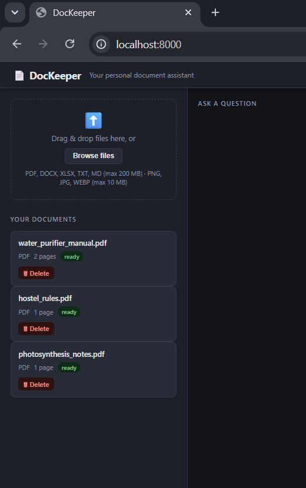
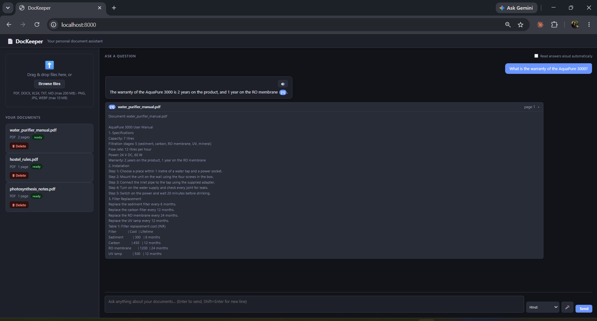
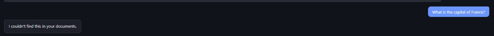
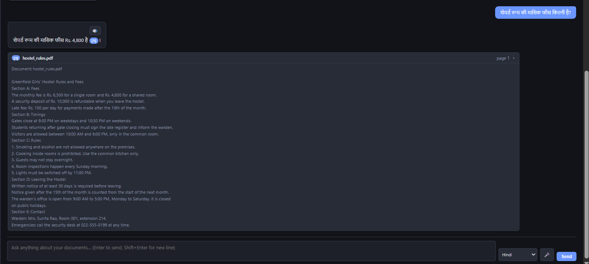

# DocKeeper

A personal document keeper. Upload your documents (PDF, Word, Excel, text, images, scanned
PDFs), then ask questions in English or Hindi, by typing or by voice. Answers cite the
document and page they came from, and the app says "I couldn't find this in your
documents" instead of guessing.



## Features

- Upload PDF, DOCX, XLSX, TXT, MD and images (PNG, JPG, WEBP)
- OCR for images and scanned PDFs, using Gemini vision
- Hybrid search: meaning search (vector) plus exact keyword search, merged with
  Reciprocal Rank Fusion
- Answers with clickable citations that open the source passage and page
- Relevance gate: refuses questions the documents cannot answer
- Hindi and English questions and answers, and follow-up questions with conversation memory
- Voice input (speech recognition) and spoken answers (speech synthesis)
- Large-file handling: streamed uploads, background processing, batched embeddings with
  rate-limit retries, and recovery of jobs interrupted by a restart

## Screenshots

| Cited answer | Refusal | Hindi |
|---|---|---|
|  |  |  |

## How it works

```
UPLOAD (runs in the background)
file -> save under a uuid name -> extract text by page (OCR for scans and images)
     -> cut into overlapping chunks -> embed each chunk (Gemini, 768 numbers)
     -> store in PostgreSQL + pgvector

QUESTION
question (typed or spoken) -> rewrite follow-ups into standalone questions
     -> vector search + keyword search -> merge with RRF -> relevance gate
     -> Gemini answers only from the numbered sources, with [n] citations
```

## Tech stack

| Part | Choice |
|---|---|
| Backend | Python 3.12, FastAPI, uvicorn |
| Database | PostgreSQL 16 with pgvector (in Docker) |
| Embeddings | gemini-embedding-001, 768 dimensions |
| Answers and OCR | Gemini (model set in `.env`) |
| Parsing | PyMuPDF, python-docx, openpyxl |
| Frontend | Plain HTML, CSS and JavaScript (no framework) |
| Voice | Browser SpeechRecognition and speechSynthesis |

## Setup

You need Python 3.12, Docker Desktop and a Gemini API key from Google AI Studio.

```
git clone https://github.com/purvabhawsar23-dev/dockeeper.git
cd dockeeper
py -3.12 -m venv venv
venv\Scripts\activate
pip install -r requirements.txt
copy .env.example .env
```

Edit `.env`: set a database password and your `GEMINI_API_KEY`, with no quotes. Set
`CHAT_MODEL` to a current Gemini Flash model ID from your AI Studio model list, because
model IDs change.

```
docker compose up -d
uvicorn app.main:app --reload
```

Open http://localhost:8000/ (the API docs are at http://localhost:8000/docs).

## API endpoints

| Method | Path | Purpose |
|---|---|---|
| GET | `/health` | Database and pgvector check |
| POST | `/upload` | Upload a file and start processing |
| GET | `/documents` | List documents |
| GET | `/documents/{id}/status` | Status, error message, chunks stored |
| POST | `/documents/{id}/process` | Reprocess a document |
| GET | `/documents/{id}/preview` | Debug: extracted text |
| DELETE | `/documents/{id}` | Delete a document and its chunks |
| GET | `/search`, `/search/hybrid` | Debug: vector and hybrid search |
| POST | `/chat` | Ask a question, get a cited answer |

## Evaluation

I tested 35 questions on three small documents, including 5 that must be refused.
The score went from 29 of 35 to 34 of 35 after fixing the answer prompt and the relevance
threshold. A 120-page PDF was processed with no lost pages. The questions and scoring
script were drafted with AI assistance, and the final score is not a blind test.
Full results, including every change and the known miss: [RESULTS.md](RESULTS.md).

## Limitations

- The evaluation is small (35 questions, 4 short documents).
- Short questions can score below the relevance threshold even when the answer exists
  (for example, "What is the emergency number?").
- Scanned-PDF OCR uses one Gemini request per page and is limited to 30 pages per file.
- Free-tier API limits apply and can change, so large batches take time.
- Your document text is sent to Google's Gemini API. On the free tier, Google may use it
  to improve its products, so do not use sensitive documents.
- Speech recognition works in Chrome and sends audio to Google's service. A Hindi voice
  for spoken answers depends on the voices installed on your device.
- Single user, no login.

## How this was built

Built with AI assistance: the code was generated by an AI coding agent from prompts I
ran and reviewed, with design guidance from an AI assistant. I ran every test, checked
the failures against the documents, and made the fixes documented in RESULTS.md.
I made the key design decisions: PostgreSQL with pgvector, hybrid search, and the
relevance gate.